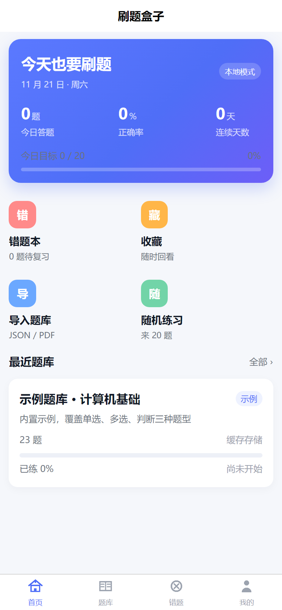
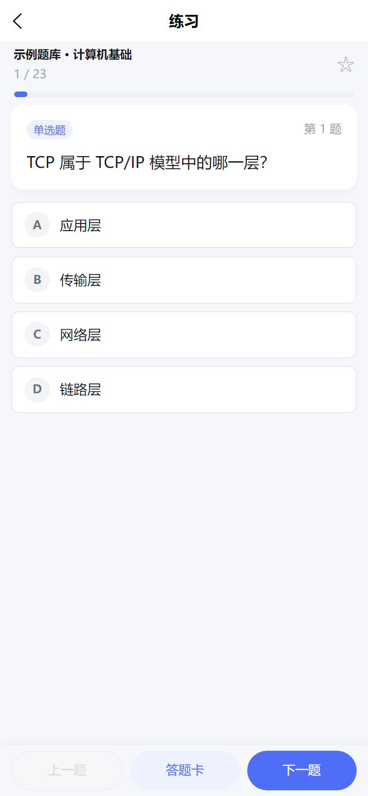
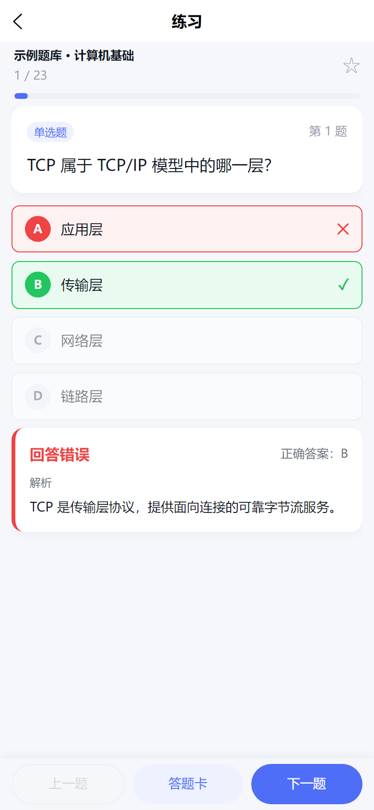
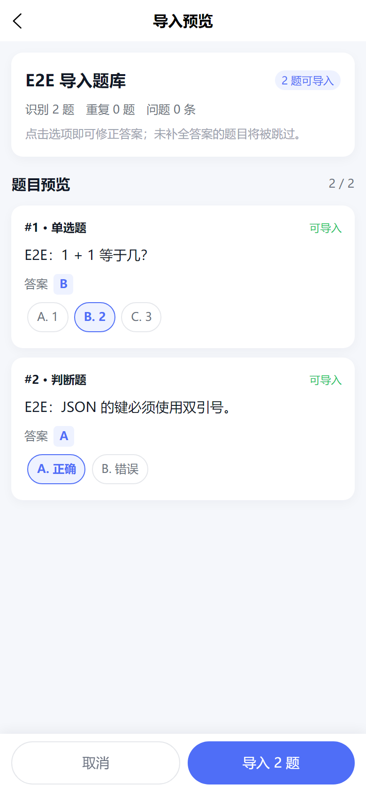

# prapers-wechat

刷题盒子：纯前端、本地存储的刷题微信小程序，基于 **uni-app + Vue3 + Vite + TypeScript + Pinia**。

- 无服务端、无账号、无网络请求
- 题库、进度、错题、收藏、统计全部保存在本机
- 支持 JSON 题库导入、刷题、错题本、收藏、统计、模拟考试、备份恢复

完整设计文档见上级目录：[刷题小程序设计方案.md](../刷题小程序设计方案.md)。

## 界面预览

以下为 H5 调试端截图（微信端导航栏与 tabBar 会略有差异）：

| 首页 | 刷题 |
|---|---|
|  |  |

| 判分与解析 | 导入预览 |
|---|---|
|  |  |


## 环境要求

- Node.js 18+ / 20+（本机验证使用 Node 24.21.0）
- 微信开发者工具（用于预览真机效果）
- npm 或 pnpm

## 开始

```bash
npm install
npm run dev:mp-weixin
```

然后在微信开发者工具中导入 `dist/dev/mp-weixin`。

发布构建：

```bash
npm run build:mp-weixin
```

导入 `dist/build/mp-weixin`。

> `src/manifest.json` 中 `mp-weixin.appid` 当前为 `touristappid`，正式发布前替换为你自己的小程序 AppID。

H5 仅用于开发调试：

```bash
npm run dev:h5
npm run build:h5
npm run serve:h5   # 本地静态预览 dist/build/h5
```

## 已有功能

- 题库列表、题库详情、删除、重置进度
- JSON 导入：格式校验、错误定位、预览修正答案、查重
- 单选 / 多选 / 判断
- 顺序练习、随机练习、错题重练、收藏练习、模拟考试
- 即时判分、答案与解析、答题卡、断点续刷
- 错题自动收录、连续答对移出、收藏
- 今日数据、累计正确率、连续天数、最近 7 天、分库进度
- 设置：解析显示、自动下一题、字号、每日目标、错题阈值、多选少分、考试题量/时长
- 备份导出与恢复（`quizbackup/v1`）
- 内置 23 题示例题库

## 暂未实现（按设计文档属于 P1/P2）

- **PDF 导入**：方案要求先做 pdf.js 小程序端文本提取 POC（Gate），当前入口页明确说明并用 JSON 导入兜底
- 章节筛选、题目列表/详情、文本粘贴导入
- 图片题、深色模式、间隔重复

## 目录

```text
src/
├── pages/               页面
├── components/          通用组件
├── stores/              Pinia
├── services/            题库、备份、文件选择
├── core/
│   ├── quiz/            判分、选题
│   ├── import/          归一化、JSON 解析
│   ├── storage/         缓存/文件驱动、分片、记录
│   └── stats.ts         统计纯函数
├── types/               领域类型
├── utils/               工具
└── static/              示例题库、tabBar 图标
tests/unit/              Vitest 单元测试
tests/fixtures/          导入测试文件
docs/screenshots/        界面截图
scripts/gen-icons.mjs    tabBar 图标生成脚本
scripts/serve-h5.mjs     H5 静态预览服务
scripts/e2e-smoke.mjs    H5 端到端冒烟测试（可选）
```

## 存储说明

- 微信端：题目正文写入 `USER_DATA_PATH/qb/{bankId}-chunk-*.json`，索引/进度/错题/收藏/统计/会话写入小程序缓存
- H5：所有数据走缓存分片，便于调试
- 缓存单 key 控制在 250KB 以内，避免 1MB/key 限制
- 清除微信缓存或卸载小程序会丢数据，请使用「备份与恢复」导出 `.json` 文件并发送到聊天保存

## 测试与检查

```bash
npm test
npm run type-check
```

当前 7 个测试文件、46 个用例，覆盖判分、答案归一化、JSON 解析、选题、统计、题库分片、备份恢复。

### H5 端到端冒烟测试（可选）

需要本机安装 Edge，并先启动静态服务：

```bash
npm run build:h5
npm run serve:h5
# 另开一个终端
node scripts/e2e-smoke.mjs
```

脚本会验证：首页 → 题库详情 → 顺序答题 → 判分/解析 → 答题卡 → 收藏 → 错题 → 模拟考试交卷 → 结果页 → JSON 导入。脚本会使用本机 Edge 的 CDP 端口 `9223`，并临时启动无头浏览器。

## 当前验证结果

- `npm run type-check` 通过
- `npm run build:mp-weixin` 通过，主包约 226KB
- `npm run build:h5` 通过
- 46 个单元/集成测试通过
- H5 端到端冒烟测试通过
- 未在微信开发者工具/真机运行（本机默认路径未发现微信开发者工具）；`dist/build/mp-weixin` 可直接导入验证

## 与设计文档的差异

- PDF 导入按设计中的 M0 Gate 暂缓，当前提供说明页与 JSON 兜底
- 文件模式使用扁平命名 `qb/{bankId}-chunk-*.json`（设计文档中为子目录命名）
- 未实现：答题流水、题目列表/详情、章节筛选、背题模式、图片题
- 示例题库实际为 23 题
- 退出答题页依赖系统返回手势/按钮，不再额外弹确认框；会话与进度会自动保存

## JSON 题库格式

```json
{
  "schema": "quizbank/v1",
  "meta": { "name": "示例题库" },
  "questions": [
    {
      "type": "single",
      "stem": "TCP 属于哪一层协议？",
      "options": [
        { "key": "A", "text": "应用层" },
        { "key": "B", "text": "传输层" }
      ],
      "answer": ["B"],
      "analysis": "TCP 是传输层协议。"
    }
  ]
}
```

- `type`：`single` / `multiple` / `judge`
- 判断题答案：`A` = 正确，`B` = 错误
- 多选题答案：`["A", "C"]`
- 微信中请先把 JSON 文件发送到「文件传输助手」或任意聊天，再从聊天文件中选择
